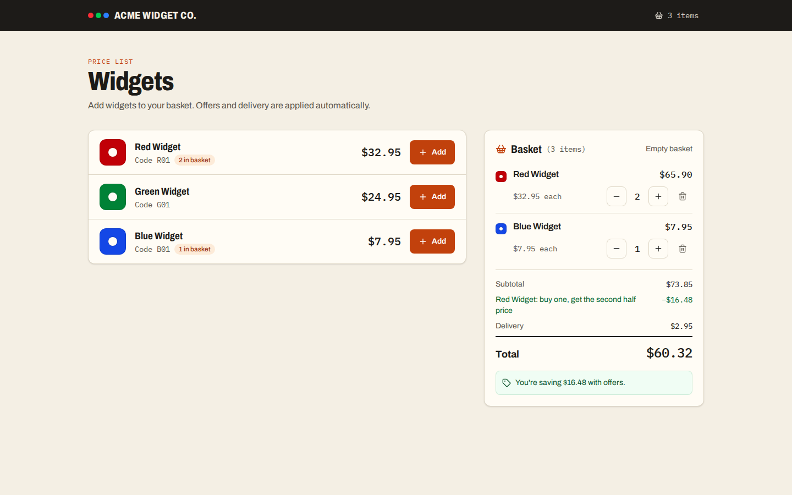
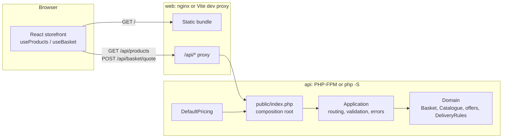
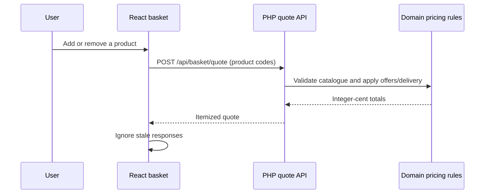
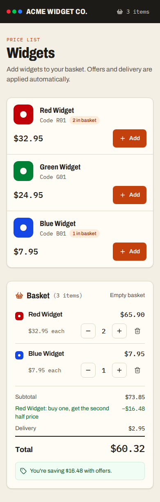

# Acme Widget Co — Basket

A proof-of-concept shopping basket for Acme Widget Co. A PHP pricing API owns every rule (catalogue, the red-widget half-price offer, tiered delivery), and a React + TypeScript storefront lets you build a basket and shows the server's price breakdown as you go.

It answers the ThriveCart take-home brief in [`docs/ThriveCart-Assessment.md`](docs/ThriveCart-Assessment.md): a `Basket` class with `add()` and `total()` that reproduces the four expected totals exactly, plus a small UI on top.



- **`apps/api`**: PHP 8.3 domain model (`Basket`, `Catalogue`, offers, delivery rules) behind a stateless JSON API with no framework. Composer, PHPUnit, PHPStan (level `max`) and PHP-CS-Fixer.
- **`apps/web`**: React 19, TypeScript, Vite and Tailwind CSS 4. Vitest and React Testing Library.
- **Turborepo + pnpm** run `dev`, `lint`, `typecheck`, `test` and `build` across both apps. The PHP app has a small `package.json` whose scripts call `composer`, so Turbo can orchestrate it without pnpm ever installing PHP dependencies.

## Quick start with Docker

The quickest way to see it running needs only Docker:

```bash
docker compose up --build
```

Open http://localhost:5173. Compose builds two images:

- **`api`** (`Dockerfile.api`): Composer installs production dependencies, then the code runs on `php:8.3-fpm-alpine` as `www-data` with a read-only root filesystem.
- **`web`** (`Dockerfile.web`): pnpm builds the Vite bundle on Node 22, and unprivileged nginx serves it. nginx forwards `/api/` to PHP-FPM over FastCGI, so the browser talks to one origin.

No secrets, database or provider keys are involved. Stop with `docker compose down --rmi local`.

## Local development

| Tool     | Version                                           | Notes                                   |
| -------- | ------------------------------------------------- | --------------------------------------- |
| Node.js  | 22.22.2+ (pinned `22.23.4` in `.nvmrc`)           | `nvm use` picks up `.nvmrc`             |
| pnpm     | 10 (pinned `pnpm@10.34.9` via `packageManager`)   | `corepack enable` installs it           |
| PHP      | 8.3+ with `ext-json`                              | Must be on `PATH`                       |
| Composer | 2.x                                               | Must be on `PATH`                       |

```bash
nvm use                      # Node 22.23.4 from .nvmrc
corepack enable              # pnpm 10.34.9 from package.json
pnpm install
(cd apps/api && composer install)

pnpm dev
```

`pnpm dev` starts both apps:

| App                       | URL                   |
| ------------------------- | --------------------- |
| Web (Vite)                | http://localhost:5173 |
| API (PHP built-in server) | http://127.0.0.1:8000 |

The Vite dev server proxies `/api/*` to the PHP server, so no CORS configuration is needed. To point the proxy elsewhere, copy `.env.example` to `apps/web/.env.local` and change `API_PROXY_TARGET`.

### Commands

All commands run from the repository root and fan out through Turborepo.

| Command          | Web (`apps/web`)                              | API (`apps/api`)                                   |
| ---------------- | --------------------------------------------- | -------------------------------------------------- |
| `pnpm dev`       | Vite dev server                               | `php -S 127.0.0.1:8000 -t public public/index.php` |
| `pnpm lint`      | ESLint (type-aware) + Prettier check          | `composer validate --strict` + PHP-CS-Fixer check  |
| `pnpm typecheck` | `tsc --noEmit` (strict)                       | PHPStan at level `max`                             |
| `pnpm test`      | Vitest + React Testing Library (61 tests)     | PHPUnit unit + API integration suites (106 tests)  |
| `pnpm build`     | `tsc` + `vite build` → `apps/web/dist`        | `php -l` syntax check of every PHP file            |
| `pnpm format`    | Prettier write                                | PHP-CS-Fixer fix                                   |
| `pnpm check`     | lint, typecheck, test and build for both apps |                                                    |

PHP has no compile step, so the API's `build` is a syntax check. That gives `pnpm build` a fast way to catch broken PHP. PHP-CS-Fixer uses the `@PER-CS2.0` ruleset, the successor to PSR-12.

## Architecture



Every basket change is priced by the server:



```text
apps/
├── api/                        Composer project (PSR-4: Acme\Basket\ → src/)
│   ├── public/index.php        Front controller + composition root
│   ├── src/Config/             DefaultPricing: products, delivery tiers, offers
│   ├── src/Domain/             Framework-free pricing model
│   ├── src/Http/               Request, JsonResponse, Application (router), QuoteRequestParser
│   ├── tests/Unit/             Domain and HTTP value-object tests
│   └── tests/Integration/      In-process HTTP tests against Application::handle()
└── web/src/
    ├── components/             ProductList, ProductCard, BasketPanel, PriceSummary, WidgetSwatch, …
    ├── hooks/                  useProducts, useBasket
    ├── lib/                    Typed API client, basket entry helpers, money formatting
    └── test/                   Fixtures and an in-memory fetch mock of the API
docker/nginx.conf, Dockerfile.api, Dockerfile.web, docker-compose.yml
```

## How pricing works

### Rules

| Product      | Code  | Price  |
| ------------ | ----- | ------ |
| Red Widget   | `R01` | $32.95 |
| Green Widget | `G01` | $24.95 |
| Blue Widget  | `B01` | $7.95  |

| Discounted subtotal     | Delivery |
| ----------------------- | -------- |
| under $50.00            | $4.95    |
| $50.00 up to $89.99     | $2.95    |
| $90.00 or more          | Free     |

**Offer:** buy one red widget, get the second half price.

### Calculation order

1. `subtotal` = sum of unit prices.
2. `discount` = sum of every offer's discount, capped at the subtotal.
3. `discountedSubtotal` = `subtotal − discount`.
4. `delivery` = the charge for `discountedSubtotal`. An empty basket has no delivery.
5. `total` = `discountedSubtotal + delivery`.

### Assumptions and decisions

- **Integer cents everywhere.** Prices, discounts, delivery and totals are `int` cents in PHP and `number` cents in the API and frontend. There are no floats, so there is no floating-point drift. The frontend only divides by 100 when formatting with `Intl.NumberFormat`.
- **Half-price rounding.** Half of $32.95 is 1647.5 cents. The discount is rounded **up** to 1648 cents, so the second widget costs $16.47. This is the only rounding that reproduces the expected `R01, R01 = $54.37`. The discount for `n` red widgets is `floor(n / 2) × 1648` cents.
- **Pairs only.** Every *complete* pair of red widgets earns one half-price widget. 1 red = no discount, 2 or 3 reds = 1 discount, 4 reds = 2 discounts. Other products are never discounted.
- **Delivery uses the discounted subtotal.** The brief says delivery depends on "the amount spent", and the customer spends the discounted amount. The examples confirm this: `R01, R01` is $65.90 before the offer (which would mean $2.95 delivery) but $49.42 after it, so delivery is $4.95 and the total is $54.37.
- **Thresholds are inclusive.** Exactly $50.00 pays $2.95; exactly $90.00 ships free.
- **Empty basket costs $0.00, with no delivery charge.** You can't ship nothing. This is a POC assumption, so a real checkout would simply not allow an empty order.
- **Product codes are case-sensitive.** `r01` is an unknown product.

### Acceptance examples

These are covered by parameterised PHPUnit tests (`BasketTest`, `ApiTest`) and React tests (`App.test.tsx`).

| Products                  | Calculation (cents)                 | Total      |
| ------------------------- | ----------------------------------- | ---------- |
| `B01, G01`                | 795 + 2495 + 495                    | **$37.85** |
| `R01, R01`                | 6590 − 1648 + 495                   | **$54.37** |
| `R01, G01`                | 3295 + 2495 + 295                   | **$60.85** |
| `B01, B01, R01, R01, R01` | 1590 + 9885 − 1648 + 0              | **$98.27** |

## Using the `Basket` class

The basket receives its catalogue, delivery rules and offers through its constructor. The business values live in one place, `Acme\Basket\Config\DefaultPricing`, so changing prices, tiers or offers needs no change to `Basket`.

```php
use Acme\Basket\Domain\Basket;
use Acme\Basket\Domain\BuyOneGetOneHalfPriceOffer;
use Acme\Basket\Domain\Catalogue;
use Acme\Basket\Domain\DeliveryRules;
use Acme\Basket\Domain\DeliveryTier;
use Acme\Basket\Domain\Product;

$catalogue = new Catalogue(
    new Product('R01', 'Red Widget', 3295),
    new Product('G01', 'Green Widget', 2495),
    new Product('B01', 'Blue Widget', 795),
);

$basket = new Basket(
    $catalogue,
    new DeliveryRules(
        new DeliveryTier(minSubtotalCents: 0, chargeCents: 495),
        new DeliveryTier(minSubtotalCents: 5000, chargeCents: 295),
        new DeliveryTier(minSubtotalCents: 9000, chargeCents: 0),
    ),
    [new BuyOneGetOneHalfPriceOffer($catalogue->get('R01'))],
);

$basket->add('R01');
$basket->add('R01');

$basket->total();      // 5437 (cents) = $54.37
$basket->breakdown();  // BasketTotals: lines, applied offers, subtotal, discount, delivery, total
```

`add()` throws `UnknownProductException` for codes that aren't in the catalogue. `total()` and `breakdown()` share one calculation path, don't mutate the basket, and give the same result for any order of `add()` calls.

`BuyOneGetOneHalfPriceOffer` works for any product. A "buy one green, get one half price" trial is one more line in `DefaultPricing::offers()`: `new BuyOneGetOneHalfPriceOffer($catalogue->get('G01'))`. The offer takes a `Product` from the catalogue rather than a code, so an offer for a product that isn't in the catalogue throws `UnknownProductException` at start-up instead of silently never applying. Its label defaults to `"<product name>: buy one, get the second half price"` and can be overridden.

Other kinds of offer implement `OfferInterface`, which has `label()` and `discountCents(array $items): int`, and are passed to the constructor. `BasketTest::testAcceptsAdditionalOffersWithoutChangingTheBasket` shows this.

## API

The responses below were captured from the Docker Compose stack (port 5173, proxied by nginx). With `pnpm dev` the PHP server answers directly on port 8000 with the same bodies.

The API is stateless: the client sends the product codes in its basket and the server returns an authoritative price breakdown. Client-supplied prices or totals are never trusted; unknown request fields are ignored.

### `GET /api/products`

```bash
curl http://localhost:5173/api/products
```

```json
{
  "products": [
    { "code": "R01", "name": "Red Widget", "priceCents": 3295 },
    { "code": "G01", "name": "Green Widget", "priceCents": 2495 },
    { "code": "B01", "name": "Blue Widget", "priceCents": 795 }
  ],
  "maxBasketItems": 100
}
```

### `POST /api/basket/quote`

```bash
curl -X POST http://localhost:5173/api/basket/quote \
  -H 'Content-Type: application/json' \
  -d '{"items":["R01","R01","B01"]}'
```

```json
{
  "items": [
    { "code": "R01", "name": "Red Widget", "unitPriceCents": 3295, "quantity": 2, "lineSubtotalCents": 6590 },
    { "code": "B01", "name": "Blue Widget", "unitPriceCents": 795, "quantity": 1, "lineSubtotalCents": 795 }
  ],
  "appliedOffers": [{ "label": "Red Widget: buy one, get the second half price", "discountCents": 1648 }],
  "subtotalCents": 7385,
  "discountCents": 1648,
  "discountedSubtotalCents": 5737,
  "deliveryCents": 295,
  "totalCents": 6032
}
```

`items` holds one product code per unit and is limited to 100 entries, so the cap counts units, not distinct products. It's a request-size guard for this proof of concept. `GET /api/products` publishes the same number as `maxBasketItems`, and the frontend stops the basket from growing past it.

### `GET /api/health`

Returns `{"status":"ok"}`.

### Errors

Every error is JSON in the same shape:

```bash
curl -i -X POST http://localhost:5173/api/basket/quote -d '{"items":["XYZ"]}'
# HTTP/1.1 422
# {"error":{"code":"INVALID_PRODUCT","message":"Unknown product code: XYZ"}}

curl -i -X DELETE http://localhost:5173/api/products
# HTTP/1.1 405 Method Not Allowed
# Allow: GET
# {"error":{"code":"METHOD_NOT_ALLOWED","message":"DELETE is not supported for /api/products."}}
```

| Status | `code`               | When                                                       |
| ------ | -------------------- | ---------------------------------------------------------- |
| 400    | `INVALID_JSON`       | Body is not valid JSON                                     |
| 400    | `INVALID_PAYLOAD`    | Body is not an object, or `items` is missing / not an array |
| 422    | `INVALID_ITEM`       | An item is not a non-empty string (max 32 characters)     |
| 422    | `INVALID_PRODUCT`    | An item is not a known product code                        |
| 422    | `TOO_MANY_ITEMS`     | More than 100 items                                        |
| 404    | `NOT_FOUND`          | Unknown route                                              |
| 405    | `METHOD_NOT_ALLOWED` | Known route, wrong method (includes an `Allow` header)     |
| 500    | `INTERNAL_ERROR`     | Unexpected failure (details are logged, not returned)      |

## Frontend

- Products and prices come from `GET /api/products`. Nothing about pricing is hard-coded in the UI.
- The basket (product code → quantity) lives in React state (`useBasket`). Changes are pure functions in `lib/basketEntries.ts` applied as functional state updates, so several changes in one render batch all land. After every change the full list of codes goes to `POST /api/basket/quote`, and the UI shows the server's subtotal, offers, delivery and total.
- **Stale responses can't win.** Each basket change aborts the in-flight request with an `AbortController`, and each result is tagged with the basket it priced, so only the quote for the current basket is shown.
- Loading, error and empty states cover both products and quotes. Retry is offered only when it could help: network failures and 5xx responses. A 4xx shows the server's message without a retry button. While a new quote loads, the previous totals stay visible but dimmed, so the layout doesn't jump.
- **Basket limit:** once the basket holds `maxBasketItems` units, the Add and "+" buttons are disabled and the basket says so. The API still enforces the limit itself.
- **Look:** the storefront reads like a printed trade price list: warm paper and ink with a safety-orange accent, Archivo (condensed for headings) with IBM Plex Mono for product codes and prices, and products as rows of one sheet rather than a grid of cards.
- **Accessibility:** semantic landmarks and headings, labelled icon buttons, `role="status"` and `role="alert"` messages, visible focus rings, keyboard operation and `prefers-reduced-motion` support.
- **Responsive:** one column on phones (the header item count links to the basket); on large screens the price list sits beside a sticky basket.



### Design decisions

- **No PHP framework.** Three routes don't justify Laravel or Slim. A ~100-line `Application` class does routing, validation and error mapping, and the domain has no framework dependencies. Its only dev dependencies are PHPUnit, PHPStan and PHP-CS-Fixer.
- **Small seams, not a rules engine.** `OfferInterface` and ordered `DeliveryTier`s cover the extension points the brief hints at (more products, offers and delivery bands) without speculative abstractions.
- **Stateless quotes.** The client sends the whole basket each time. There are no sessions or persistence, results are reproducible, and the server is easy to test. The PHP `Basket` still has the stateful `add()` / `total()` interface the brief asks for; the API builds one per request.
- **Tests run in-process.** The API integration tests drive `Application::handle()` directly, the same object `public/index.php` uses, so no running server is needed.
- **No client data library.** `fetch`, `useState` and two small hooks are enough here; React Query or Redux would add weight without solving a real problem.

## Limitations

- The basket lives in browser memory and is lost on reload. There is no checkout, persistence, authentication or stock.
- One currency (USD); amounts assume two-decimal cents.
- Offers are evaluated independently and their discounts summed. Offers that compete for the same items would need an explicit precedence rule.
- `pnpm dev` uses the PHP built-in server, which is for local development only. The Compose stack shows the production shape: nginx in front of PHP-FPM.
- The storefront loads Archivo and IBM Plex Mono from Google Fonts. Offline it falls back to the system font stack.
- TypeScript stays on 6.0: typescript-eslint 8 does not support TypeScript 7 yet.

## License

MIT, see [`LICENSE`](LICENSE).
